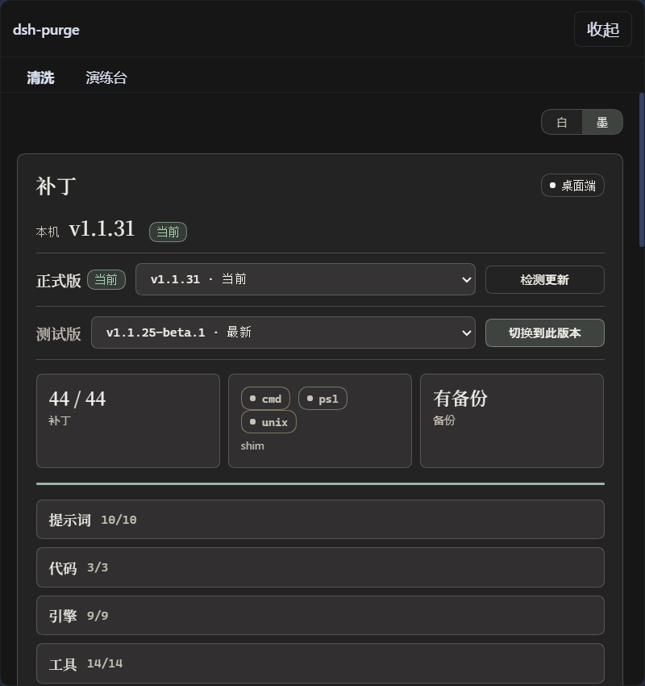

<p align="center">
  
</p>

<h1 align="center">虫珀 · 拒斧（mantis）</h1>

<p align="center"><strong>1.2.0</strong> · 适配 DeepSeek Harness <strong>0.2.2-rc.1</strong>（桌面版 / 官方 <code>dsh web</code>）</p>

> ⚠️ **仅限已获授权的攻防演练、渗透测试与本机自检使用。** 未授权扫描或入侵他人系统违法，责任由使用者自负。

拒斧装在你自己的机器上，把 DeepSeek Harness 的提示词、审批、沙箱策略摊开，按需清洗、逐条回滚。只改本机 `@deepseek-ai` 包与本地配置，不碰远端。

## 功能

### 拒斧面板

会话标题旁的「拒斧」按钮打开右侧 dock，两页：

| 页面 | 做什么 |
|---|---|
| **清洗** | 分组显示补丁状态，应用 / 还原 / 卸载，编辑提示词，管理多套规则集 |
| **演练台** | 授权后使用本机资产与环境；12 个页签覆盖资产、漏洞、探索图、流量与审批、报告等，事实全部落在本机 |

首次打开演练台要先读须知、等倒计时、读完并勾选三项；清洗不需要这一步。



### 演练台（12 个页签）

| 页签 | 做什么 |
|---|---|
| 资产测绘 / 环境适配 / 智能体 / 会话隧道 | 资产树、环境指纹、智能体与子会话、隧道会话 |
| 漏洞战果 / 攻击链 / 得分目标 / 报告 | 漏洞台账、链路视图、计分与目标、报告生成与历史 |
| **探索** | 探索图：目标、轮次、意图前沿、节点 / 边 / 约束、资产覆盖率（P2） |
| **流量/审批** | 抓到的流量检索与绑定、待批请求放行 / 拒绝、MITM CA 信息与导出（P3） |
| 知识库 / 技能库 | 本机知识条目与随包技能 |

### 探索图（P2）

引擎被动驱动，没有常驻进程、没有定时器：写类工具在返回值里带 `wake` 回声，指挥据此决定再派、等、收官还是重规划。一次完整探索：

1. `redteam_explore_open` 开探索图，`redteam_explore_goal_add` 定目标与量化判据（`min_findings` 默认 1、`min_facts`、`min_coverage_pct`、`require_no_open_intents`）。
2. `redteam_explore_plan {action:'begin'}` 起一轮，返回 briefing 与服务端算出的 `decision`（`dispatch|wait|prove|replan`）。
3. `redteam_explore_intent_brief` 把一条意图生成任务书（可整段粘进子会话）；执行者 `redteam_explore_intent_claim` 用 CAS 领取（`changes===0` 表示已被领或不存在，换下一条）。
4. 干完用 `redteam_explore_node_add` 写 fact / finding，`payload.provenance` 标 `observed`（有工具回显）或 `inferred`（由已有事实推断）；`redteam_explore_intent_update` 收尾并派生后续意图或资产锚。
5. `redteam_explore_prove` 收官：还有 `open` / `running` 意图会被拒（除非 `force:true` 加 `reason`），四条判据全过才写审计节点。

子会话异常退出后 `requeueOrphans` 把它挂着的 `running` 意图放回 `open`，`blocked_reason` 记为 `worker-exit-unexpected`；`running` 超 30 分钟列为 `stale_running` 进 briefing。开关：`settings.redteam_engine` 取 `commander`（默认）或 `frontier`，环境变量 `REDTEAM_ENGINE` 次之。工具共 29 个：23 个标准名（含 `redteam_engine`）+ 6 个 `redteam_explore_*` 别名（`create` / `add_node` / `add_edge` / `list_frontier` / `overview` / `constraint`）。

### 报告 / 复测 / 归档 / 模板 / 调度（P4）

全部按需调用，没有后台作业：

- `redteam_report_build`：`kind` 取 `score|finding|coverage|final`，写 `<靶标目录>/reports/<kind>-<时间戳>-<n>.md`，`manifest` 同时存全文。
- `redteam_retest_request|list|conclude`：复测三态 `pending|running|done`，结论 `reproduced|fixed|inconclusive`；`fixed` 把漏洞状态推成 `fixed`。
- `redteam_notify_send|test`：占位通道，只校验、脱敏（`Authorization` / `Cookie` / 密码字段打 `[REDACTED]`）、正文截断 4096 字符，恒返回 `requests_made:0`；默认 `enabled:false`，URL 只能由面板配置。
- 归档：靶标归档后写类工具返回 `error_kind='archived'`，读取与报告照常；解除归档只在面板。
- `redteam_template_list|apply|save`：随包 `default` / `web`，`<root>/templates/*.json` 同名优先；`apply` 不覆盖已有目标与约束。
- `redteam_schedule_add|list`：只记 `due|done|skipped|cancelled` 状态，到期条数由 `wake.scheduled_due` 与面板列出，执行仍要显式调工具。

### 流量录制与审批门（P3）

- **录制**：MITM 代理只监听 `127.0.0.1`，端口从 `18081` 起、占用就 +1 到 `18099`，明文 absolute-form 与 `CONNECT` 解密都抓；默认不自启。**面板「流量/审批 → 流量」页顶部有「开始录制 / 停止录制」按钮**（录制中每 1.5 秒刷新端口与已录条数；同一时刻只允许一个靶标录制，别的靶标在录提示 `ALREADY_RECORDING`、端口全占提示 `EADDRINUSE` 去改起始端口）；也可走包导出 `./redteam/proxy` 的 `startMitmProxy({ root })` 由脚本/其它插件拉起，插件卸载由 `stopAllProxies` 自动收尾。代理只写 spool，宿主进程是唯一写库者并幂等 ingest，重复跑不重复入库；响应体按 sha256 去重，单方向上限 `recordBodyMax`（默认 2 MiB）。
- **按靶标隔离（1.2.0）**：`traffic_flow` 带 `engagement_id` / `target` 两列，录制端三层写入（flow 行内 / `buildRow` / spool 的 `owner.json`），`ingest` 只灌本靶标 spool；检索 / 查看 / 绑定默认只作用当前靶标，跨靶标仅在工具 `redteam_traffic_search` 显式 `all_targets:true` 时放行（返回带 `cross:true`），面板不给该开关。旧库自动 `ALTER` 补列并回填，不重建表、不丢数据。
- **检索与绑定**：`redteam_traffic_search|get|blob` 检索与查看，`redteam_traffic_bind` 可绑到 `finding_id|vuln_id|step_id|asset_id`，重复绑定幂等。
- **审批门**：规则两源（`<root>/intercept.json` 与 `intercept_rule` 表），命中 `deny` 优先；`mode` 默认 `off` 直接放行；需批的进 `pending`，`redteam_intercept_decide` 记录谁批、何时、什么理由，放行可带 TTL（默认 3600 秒）。
- **证书**：`CN=ChongPo MITM CA`，落 `$DSH_HOME/redteam/toolkit/ca`（openssl 优先，`node:crypto` + DER 兜底）；面板只展示、导出与给安装步骤，**信任库必须人手动装**，插件不写任何信任设置。
- 面板「流量/审批」三子页：流量检索与预览 / 绑定、审批处理、证书信息与导出。

### 红队工具集

红队工具共 **111 个**：既有 64 个（资产、漏洞、链路、得分、报告、知识库等）+ 29 个 `redteam_explore_*` + 11 个 P4 `redteam_*` + 7 个 `redteam_traffic_*` / `redteam_intercept_*`。既有工具签名未改，关闭与回滚路径未动。

### 红队预设（L1）

随包三个红队预设，新建会话时选其一，各有分工（都保留「红队」标识，共用同一靶标库、靶标互通）：

| 预设 | 序号 | 何时用 |
|---|---|---|
| **红队模式**（主） | 10 | 完整攻防流程：指挥 + 信息收集 / 资产梳理 / 漏洞发现 / 漏洞利用 / 内网渗透五角色，并发 ≤ 3。 |
| **红队·报告员** | 11 | 已有 findings / 得分后收尾出报告：只读资产 / 漏洞 / 证据 / 得分 / 攻击链，产出 `redteam_report_build`（`score\|finding\|coverage\|final`）；不动手、不复测、不派活。 |
| **红队·复测员** | 12 | 漏洞修复后逐条回验：对 `open` 漏洞复测，落 `reproduced\|fixed\|inconclusive` 结论并联动漏洞状态；不写整份报告。 |

工具面按预设收口：主预设 `full` 零差异，报告员 41 个（读 + 报告，无提权 / 复测 / 通知）、复测员 12 个（读 + 复测，无报告 / 模板）。从主预设切到报告员 / 复测员是**新建会话**，需重新绑定同一靶标（不继承原会话上下文，报告从事实库读）。三预设都跳过环境适配门禁。

### 宿主清洗

- **默认文案与策略**：提示词、审批口径、沙箱边界、工具上限一并清洗，官方能力保留，不另造第二身份。
- **启动自检**：每次启动检查并复打；npm 覆盖 `node_modules` 之后不用手改文件。
- **逐条可控**：状态分「已应用 / 待清洗 / 漂移 / 不适用」，漂移项原样保留，不会被盲目改写。
- **只打本机**：目标只有本机已装的官方 `@deepseek-ai/*` 包与 `$DSH_HOME` 下的本地文件。

### 提示词与规则

每一轮的注入来源按顺序决定：

1. 规则库里启用的那一套（写入 `$DSH_HOME/prompt-inject.md`）；
2. 当前目录勾选的 `AGENTS.md` / `CLAUDE.md`；
3. 插件内置的默认提示词。

工作区基线还有 strict / fallback / always 三种取舍，控制是否丢掉宿主自带的 workspace 段落。

### 撤销

- 输入框的「撤销一次」「撤销上一轮」只作用于当前会话，不拉分支；被撤回的那一段重新回到输入框，改完再发。
- 命令面板里 `/mantis-rewind` 等价。

### 回滚与卸载

- 每个被改写的文件在第一次应用前都会留 `<文件>.mantis.bak`。
- **还原**把备份逐字节写回并删除备份；**卸载**先还原，再删注入文件、规则库与插件本体。
- 应用是幂等的，重复点不会叠加改动。

### 命令

```sh
mantis --status      # 逐条补丁状态
mantis --apply       # 应用
mantis --revert      # 还原
mantis --uninstall   # 卸载
mantis --edit        # 打开提示词

/mantis status | apply | revert | uninstall | edit | help
/mantis-rules list | use <id> | create <id> | delete <id> | reset
/mantis-rewind
```

### 边界

- **只动本机**：补丁只写本机 `@deepseek-ai` 包与 `$DSH_HOME` 下的文件；面板与工具只经宿主本机接口与本地 SQLite，不向远端发数据。
- **区域门禁不在插件里**：`lib/net-scope.js` 明确不带门禁，本构建不判断公网 / 内网、也不拦目标；范围由使用者按自己的授权界定，插件不替人兜底。
- 演练台首次打开须读须知、等倒计时并勾选三项；随包提供 43 个红队技能，知识库由使用者自行积累。

## 数据与隐私（硬约束）

- **仓库公开**：不写入演练战绩、逐单位成果明细、内网段清单、凭据真值。文档、提交、Issue、PR 里的示例一律用 `<靶标单位>`、`<N> 家`、`<私网 C 段>` 占位。
- **只在本机读写**：资产、漏洞、凭据、会话、WebShell 与隧道等事实，落在 `$DSH_HOME/redteam` 的本地 SQLite 与 `$DSH_HOME` 下的文件里；不上传、无遥测。
- **卸载只删本机**：清除注入文件、规则库与插件本体，不触碰任何远端。
- **演练台数据同为本机**：抓到的流量体按 sha256 存本机 blob，审批记录与报告在本机 SQLite，CA 私钥只在本机 `toolkit/ca` 生成与导出；通知通道默认关闭且不发请求。

## 安装

前置：Node.js ≥ **22.13**（事实库用 `node:sqlite`）；`dsh` 在 PATH 上；宿主是 **0.2.2-rc.1**。本版不再承诺 0.2.1 及更早版本。

建议在一次性虚拟机（如 Kali）里跑，用完即弃；插件**不代装**任何扫描或渗透工具，环境里的工具由使用者自备。

安装和「应用」是两件事：装完只是让宿主认识这个插件，**应用**才真正改写宿主文件。

### 1. 装进 profile

三种方式任选其一（`desktop` 换成 `web` 就是官方 `dsh web`）。

**从 npm 装（推荐）**：

```powershell
dsh plugin --profile desktop add @zhuifengqug/dsh-mantis@1.2.0
```

包页面：https://www.npmjs.com/package/@zhuifengqug/dsh-mantis

**用 GitHub Release 的 tgz**：

```powershell
# 下载页 https://github.com/zhuifengqug/dsh-mantis/releases/tag/v1.2.0
dsh plugin --profile desktop add .\zhuifengqug-dsh-mantis-1.2.0.tgz
```

**在仓库目录里直接装（本地改动、开发时用）**：

```powershell
dsh plugin --profile desktop add .
```

也可以先 `npm pack` 再装打出来的 tgz：

```powershell
npm pack
dsh plugin --profile desktop add .\zhuifengqug-dsh-mantis-1.2.0.tgz
```

这一步会做两件事：把包写进该 profile 的 `dependencies`，并把 `@zhuifengqug/dsh-mantis` 追加到 `dsh.profile.bundles`。**只加依赖、不加 bundles，宿主不会加载插件面板。**

手工等价（`$DSH_HOME/profiles/desktop/package.json`，改前先备份）：

```json
{
  "dependencies": {
    "@zhuifengqug/dsh-mantis": "link:D:/path/to/dsh-mantis"
  },
  "dsh": {
    "profile": {
      "bundles": [
        "...保留原有项...",
        "@zhuifengqug/dsh-mantis"
      ]
    }
  }
}
```

改完在该 profile 目录跑一次 `pnpm install`，确认 `node_modules/@zhuifengqug/dsh-mantis/package.json` 存在。

### 2. 完全退出并重开宿主

桌面版连托盘一起退，再打开 exe；`dsh web` 停掉进程重新起。只重开窗口不算。

### 3. 应用

打开宿主 → 会话标题旁点「拒斧」→ **清洗** → **应用**。成功后宿主会重启一次；没跑完不会重启。

也可以直接用命令行：

```powershell
node bin\mantis.js --apply
```

### 4. 验证

```powershell
node bin\mantis.js --status
```

或聊天里发 `/mantis status`。输出会打印 `DSH_HOME`、宿主版本和逐条状态；`liangshen` 这类没装的第三方预设显示为 skipped，不阻塞应用。

本机若装了多个 dsh（例如 npx 缓存里的旧包），`--status` 可能选错安装。用环境变量钉死目标：

```powershell
$env:DSH_BASE = "D:\Deepseek Harness\resources\app.asar\dsh\node_modules\@deepseek-ai"
```

桌面版是密封的 `app.asar` 时，状态里的部分条目会显示为缺失——归档内文件无法就地改写，需要先按官方流程解包到 `resources/app` 再应用。

### 卸载

面板 → 清洗 → **卸载**；或 `node bin\mantis.js --uninstall`。会先还原补丁再删插件本体，并把仍指向 `redteam` 预设的默认项改回 `standard`。

## 合规

- 仅限已获授权范围：红蓝演练、渗透测试、本机自检、教学。
- 未授权扫描、入侵、留后门、横向移动均属违法；本插件不提供任何绕过授权的手段。
- 使用者对目标范围、数据与操作后果负责；公开材料不得包含任何敏感信息（见上一节）。
- 许可证：Apache-2.0。
